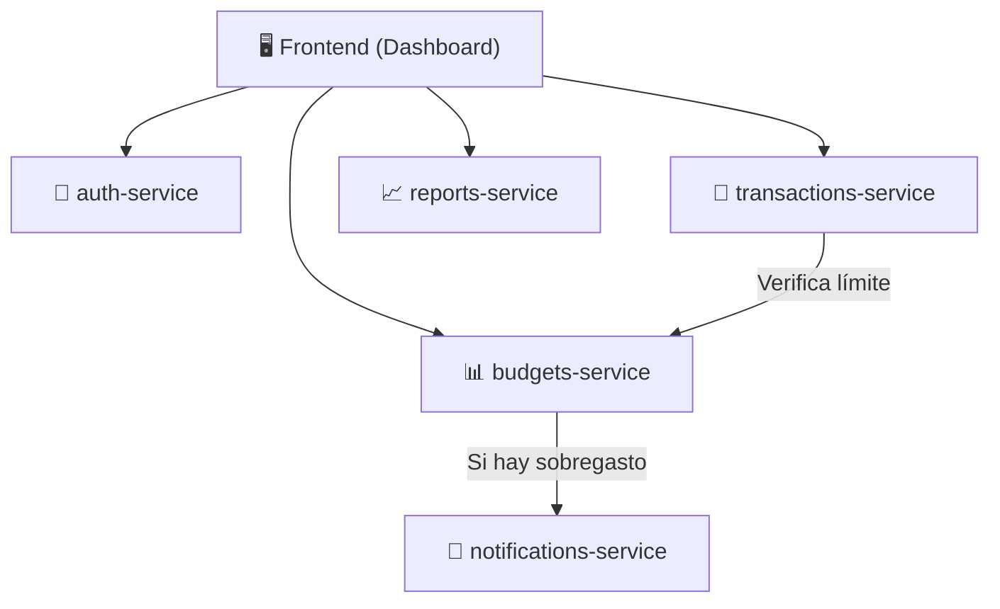

# Centavo 💰

**Centavo** es una aplicación de finanzas personales diseñada para uso individual, enfocada en el registro de gastos, la gestión de presupuestos y la emisión de alertas de sobregasto.

Este proyecto está estructurado como un **monorepo**, donde conviven el frontend principal y múltiples microservicios independientes, cada uno alojado en su propia carpeta.

---

## 📁 Estructura del Monorepo y Propósito de cada Componente

| Carpeta / Componente | Propósito |
| :--- | :--- |
| **`frontend/`** | **Dashboard Web**: Interfaz de usuario principal desde donde se registran gastos, se configuran presupuestos, se visualizan reportes y se reciben alertas. |
| **`auth-service/`** | **Servicio de Autenticación**: Gestiona el registro, inicio de sesión, emisión/validación de tokens ( sesiones) y control de acceso del usuario. |
| **`transactions-service/`** | **Servicio de Transacciones**: Encargado de crear, consultar, editar y categorizar los ingresos y gastos registrados por el usuario. |
| **`budgets-service/`** | **Servicio de Presupuestos**: Define y monitorea los límites de gasto por categoría o período, evaluando el consumo frente a las transacciones registradas. |
| **`notifications-service/`** | **Servicio de Notificaciones**: Envía alertas en tiempo real o por correo/push cuando el usuario se acerca o supera el límite de un presupuesto (sobregasto). |
| **`reports-service/`** | **Servicio de Reportes**: Genera resúmenes periódicos, estadísticas y reportes automáticos sobre el comportamiento financiero del usuario. |

---

## 🏗️ Diagrama de Arquitectura

